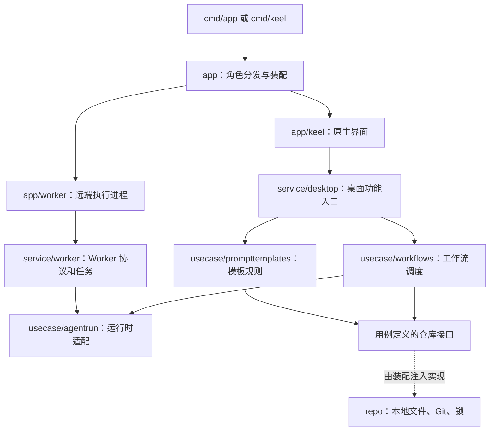

# internal 导读与边界

当前产品主线是：桌面选择工作区和任务，工作流调度 Agent，在本机或远端 Worker 执行，再把运行事件送回界面。先理解这条链路，再按功能读文件，比从目录名逐个往下翻更容易。

2026-10-14 清理了未接入当前进程入口的用户、登录、订单、计费、商品 Agent 目录、订单交付物和订单执行器，以及对应的 SQL 仓库、HTTP API、SDK 和 Wire 装配。桌面的任务、对话展示、Agent runtime 和远端 Worker 是另一套能力，继续保留。此次删除只涉及仓库代码，没有清理用户数据目录或数据库。

## 先看这五层

| 目录 | 负责什么 | 找代码时的例子 |
| --- | --- | --- |
| `app` | 启动装配、原生界面、用户交互、进程角色 | 按钮、窗口、菜单、页面、启动参数 |
| `service` | 向客户端提供完整功能，管理运行期资源 | 创建任务、继续执行、取消运行、事件订阅、远端连接 |
| `usecase` | 业务流程与执行能力 | 工作流调度、Agent 协议适配、模板展开与保存规则 |
| `domain` | 业务对象和不依赖 UI 的规则 | Task、Workflow、状态、校验、Harness 目录 |
| `repo` | 持久化及外部状态访问 | 本地 JSON/JSONL、Git、工作区锁 |

`service` 与 `usecase` 的区分是职责约定，目前还没有全部落实：`service/desktop` 仍然很宽，`usecase/agentrun` 也包含具体运行时适配。不能因为已有目录分层，就认为业务已经完全解耦。

下面画的是运行时调用，不是 Go 包的直接 import：



usecase 定义自己需要的仓库接口，repo 实现接口，装配代码负责连接两者。usecase 不直接 import `internal/repo`。domain 可以被这些层共同使用；数据类型不必为了经过 service 再复制一份。

## 每个目录具体做什么

### app：界面和进程入口

| 包 | 职责 |
| --- | --- |
| `app` | 按构建标签选择桌面或无界面入口 |
| `app/command` | 分发桌面、`worker` 和内部辅助进程角色 |
| `app/keel` | Keel 原生桌面：页面、编辑状态、输入、滚动、选区、菜单、窗口 |
| `app/keel/backend.go` | 桌面组合根：创建 store、runtime、工作流和 service，管理资源关闭 |
| `app/keel/filepicker` | 原生文件选择器的系统适配 |
| `app/worker` | Worker 参数解析、监听、配对、信号和常驻服务启动 |
| `app/shell`、`app/askpass` | 子进程 shell 和凭据询问辅助入口 |
| `app/updatehelper` | 独立更新进程，处理应用替换和回滚 |

`app/keel` 中的阅读入口：

| 想了解的功能 | 先读 |
| --- | --- |
| 应用状态、发送任务和异步回调 | `app.go`，再顺着 service 调用往下走 |
| 页面布局和输入框 | `views.go`、`composer_*.go` |
| 对话数据和正文显示 | `transcript.go`、`conversation*.go` |
| 并行工作流展示 | `conversation_timeline.go`、`conversation_lanes.go` |
| 工作流编辑器 | `workflow_dag*.go`、`workflow_library.go` |
| 文件浏览、差异和审查 | `files_panel.go`、`git_review*.go` |
| 终端显示与输入 | `terminal_screen.go`、`terminal_views.go` |
| 设置与本地界面偏好 | `settings*.go`、`navigation.go` |
| 模板库界面 | `library.go`；模板语言和文件格式已移出 UI |

折叠、选区、可见行缓存、DAG 拖动坐标、终端光标等属于界面状态，应留在 UI。调用 domain 校验来及时展示错误也合理，但后端必须独立校验，不能依赖用户一定经过某个按钮。

### domain：业务词汇和规则

| 包 | 含义 |
| --- | --- |
| `tasks` | 用户要完成的一件事，以及排队、执行、完成等任务状态 |
| `workflows` | 工作流定义、节点、依赖边、返工边、执行记录和状态规则 |
| `workspaces` | 本地或远程工作区、Git 状态等信息 |
| `settings` | 配置结构、默认值、归一化和校验 |
| `harnesses` | 支持哪些 Agent CLI/SDK，及其能力目录 |
| `prompttemplates` | 指令模板和模板库版本；不包含文件读写或界面控件 |

Task 是要做的事情，Workflow 是怎么做，Run 是某次执行，StepRun 是其中某个节点的一次执行。一个任务可能有多次执行，不能把 Task ID、Run ID 和 Agent 会话 ID 混用。

### usecase：业务流程与运行适配

| 包 | 职责 |
| --- | --- |
| `workflows` | 工作流执行、并行调度、暂停继续、返工、运行事件；先读 `usecase.go` 和 `scheduler.go` |
| `agentrun` | 对不同 Agent 的统一请求、事件和结果；包含 Codex、Claude、Modu 等适配器 |
| `agentrun/seam` | 运行环境适配，包括远程文件／命令访问和协议衔接；不是桌面 UI |
| `prompttemplates` | 模板变量与引用展开、长度和循环校验、内置模板、自定义模板编辑流程 |

`agentrun` 目前既有公共契约，也有启动进程和协议解析等实现。以后按 runtime 拆包时，应先抽出稳定的请求／事件契约，再移动适配器，避免 UI 为了引用事件类型而依赖整个执行实现。

### service：客户端可调用的能力

| 包 | 职责 |
| --- | --- |
| `desktop` | 桌面功能门面：工作区、任务、运行、Git、文件、设置、Skills、远端 Worker |
| `desktop/runstream` | 正文、工具等增量事件的发布与快照 |
| `desktop/runstate` | 运行状态、节点状态、指令等较小快照，避免每次重传整个对话 |
| `desktop/listchange` | 任务列表变更通知 |
| `worker` | Worker HTTP 客户端／服务、配对、远端执行、共享运行记录 |
| `worker/hosting`、`worker/daemon` | 桌面托管 Worker 和常驻服务生命周期 |
| `worker/sandboxfiles` | Worker 的沙箱文件访问 |
| `terminal` | PTY／ConPTY 会话、进程输入输出；终端像素和选区在 UI |
| `lsp` | 语言服务器会话和工作区文档能力 |
| `skillmanager` | Skill 文档、目录、同步目标和文件操作 |
| `appupdate` | 更新检查、下载与校验等能力 |
| `mobile` | 保留的远端 Worker 客户端服务和协议回归测试；当前 cmd 没有移动端入口 |

`desktop` 不应继续吸收所有新规则。以功能切分用例，service 只保留调用编排、客户端返回结构，以及取消句柄、连接、事件 Hub 等资源管理。Worker 当前将协议 handler 与服务放在同一包，这也是尚未拆开的边界。

### repo：数据保存在哪里

| 包 | 职责 |
| --- | --- |
| `store/local` | 本地数据目录和仓库初始化；默认 `~/.onecatch`，处理旧目录兼容 |
| `tasks` | 工作区、任务等本地记录 |
| `workflows` | 工作流定义、运行、节点、事件、指令等记录 |
| `settings` | 设置持久化与旧格式兼容 |
| `git` | Git 仓库状态和操作 |
| `workspacelock` | 防止冲突执行的工作区锁 |
| `prompttemplates` | 自定义模板 JSON、版本冲突检查和原子替换 |

`store/local` 继续保留。已删除的 `repo/store/*.go` 是另一套 SQL 连接和商城仓库装配，不能连同 `local` 一起删。

### 其他顶层包：系统能力

| 包 | 职责 |
| --- | --- |
| `platform/processexec` | 系统相关的子进程创建细节，例如 Windows 不弹控制台 |
| `remotefs` | SSH/SFTP 远程文件系统能力 |
| `sshendpoint` | SSH 地址解析与标准化 |
| `sshcredentials` | SSH 凭据存取 |
| `landiscovery` | 局域网 Worker 广播与发现 |
| `processmode` | 同一二进制的内部进程角色和可执行文件路径 |
| `buildinfo` | 构建版本信息 |

这些包不必套一层空的 usecase。保持职责具体即可；不要创建 `common`、`utils` 等包来收容无法归类的业务代码。

## UI 与后端的边界怎么落地

本次拆分了模板库和任务消息提交两条调用链。模板库结构如下：

```text
app/keel/library.go                 编辑草稿、当前选项、预览、错误展示
  → service/desktop/prompt_templates.go
  → usecase/prompttemplates         模板语言、校验、库编辑规则
  → Repository 接口
  ← repo/prompttemplates            读取旧 JSON、冲突检测、原子保存
```

内置模板资源和原有模板引擎测试也移到了用例包。旧的 `keel-prompt-templates.json` 文件名和 version=1 格式保留，界面不再读取、编码或写入这个文件。保存仍携带版本令牌；冲突时保留编辑草稿。仓库实例内的版本检查与写入有互斥保护，原子替换不等于跨进程事务。

任务消息提交统一经过 `service/desktop/run_messages.go` 的 `SubmitRunMessage`。服务读取自己的运行状态和已保存的工作流定义，决定排队、打断、恢复或投递到指定步骤；“消息已持久化但恢复失败”的结果也由服务返回，防止重复提交附件和正文。UI 保留 @ 输入解析、busy 状态和过期回调判断，不再通过界面上一帧的 Active 值选择后端操作。

后续按以下顺序继续，完成一项就迁移相应测试，不做只改目录名的搬家：

1. **桌面 service 按功能收窄**：工作区／Git／文件、运行控制、设置／Skills 分别形成能力边界。先抽有复用价值的用例，不给每个方法机械套接口。
2. **运行时契约独立**：把 Agent 请求／事件／结果与具体进程适配器分开，减少 UI 对 `usecase/agentrun` 实现包的依赖。
3. **界面装配与界面状态分开**：`backend.go` 可继续作为组合根；未来独立 bootstrap 包后，视图按功能依赖窄接口，不复制一个包含整个 Service 的巨型接口。

这次没有宣称全部解耦。完整拆分的验收条件是：业务行为能在没有 Keel 的测试中执行；换 UI 不必改业务规则；UI 不知道业务文件名、仓库和进程启动方式；后端不依赖窗口、控件、剪贴板和绘制帧。

## 检查与阅读顺序

`architecture_test.go` 检查源代码 import，包括不同平台文件：后端不能依赖 Keel 或 app；usecase 不能依赖具体 repo；视图不能直接引用 repo（`backend.go` 装配除外）。这个测试能防止依赖方向倒置，但识别不了写在 UI 函数内部的业务规则，仍需评审调用流程。

```sh
go test ./internal                                  # 依赖边界，不启动 UI
go test ./internal/usecase/prompttemplates ./internal/repo/prompttemplates
go test ./internal/service/desktop ./internal/app/keel
go test ./...                                       # 全仓回归
```

建议先读 `app/keel/backend.go` 看装配，再读 `service/desktop/app.go` 中的输入与返回类型，然后追一遍 `CreateTask → StartRun → usecase/workflows`。排查显示问题再进入 `transcript.go` 和 `conversation*.go`。修改滚动、选区或生命周期前，分别阅读 [对话选区与后台更新](../docs/keel-conversation-selection.md) 和 [托盘与窗口生命周期](../docs/keel-tray.md)。
